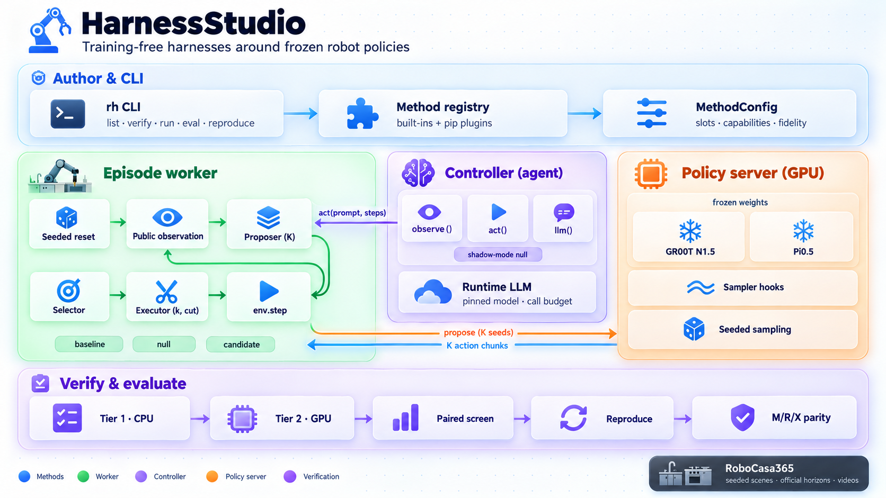

<h1 align="center">HarnessStudio</h1>

<p align="center">
  <b>Training-free harnesses around frozen robot policies.</b><br>
  Write a method as a small config, verify it in two tiers, run it against matched controls.
</p>

<p align="center">
  
</p>

A *harness* is everything around a robot policy that is not its weights: how many action samples
you draw, which one you execute, when you cut a chunk short, what instruction you send, or an LLM
agent that plans subtasks. HarnessStudio turns each harness into a **method config** that fills
typed slots around a frozen policy, the way nerfstudio turns NeRF variants into method configs.
The framework owns the episode loop, the policy server, seeding, budgets and the controls, so a
new method is usually a few dozen lines.

- **One command per stage:** `rh verify` → `rh run` → `rh eval`
- **Training-free by construction:** zero trainable parameters, frozen hashed artifacts
- **Fair by construction:** every candidate is compared with a seeded baseline *and* an
  automatically derived null arm that pays the same compute but executes native actions
- **pip-installable plugins:** ship a method as its own package via an entry point
- **Policies:** GR00T N1.5 and Pi0.5 (openpi) on RoboCasa365

## Contents

- [Install](#install)
- [Quick start](#quick-start)
- [Slots](#slots)
- [Agent harnesses: the controller slot](#agent-harnesses-the-controller-slot)
- [Built-in methods](#built-in-methods)
- [Write your own method](#write-your-own-method)
- [Verification and evaluation](#verification-and-evaluation)
- [Results](#results)
- [Repository layout](#repository-layout)
- [Limits](#limits)

## Install

```bash
git clone https://github.com/seemandhar/harnessstudio && cd harnessstudio
python3 -m venv .venv && .venv/bin/pip install -e '.[test]'
.venv/bin/rh list
```

The framework itself has no dependencies. Tier 1 runs anywhere. GPU runs need the policy and
simulator environments; point HarnessStudio at them with environment variables:

| Variable | Default | What it is |
|---|---|---|
| `HARNESSSTUDIO_WORKSPACE` | current directory | where `runs/` and caches go |
| `HARNESSSTUDIO_POLICYBENCH` | `../RobotPolicyBench` | GR00T env, RoboCasa365, robosuite and their task registry |
| `HARNESSSTUDIO_OPENPI_ROOT` | `../openpi-robocasa` | openpi checkout and venv for Pi0.5 |
| `HARNESSSTUDIO_LEASES` | nearest `.leases/` | shared GPU lease registry |

Each GPU run freezes HarnessStudio's source into the run directory and puts that copy on the
child `PYTHONPATH`, so policy environments never need HarnessStudio installed, and an edit to the
live source during a run stops it instead of silently mixing versions.

## Quick start

```bash
rh list                                              # methods, fidelity, paper, policy compatibility
rh verify medoid-bon --policy gr00t-n1.5             # tier 1: CPU contract checks, seconds
rh verify medoid-bon --policy gr00t-n1.5 --tier 2 --gpu 0   # tier 2: real episodes on one GPU
rh run medoid-bon --policy pi0.5 --group composite_unseen --task CuttingToolSelection --trial 0 --gpu 0
rh eval medoid-bon --groups atomic_seen --tasks CloseBlenderLid NavigateKitchen --trials 2 3 --gpus 0,1
```

`rh run` writes an `episode.mp4` and a per-decision `trace.jsonl`. `rh eval` runs baseline, null
and candidate on the same seeded scenes and reports paired outcomes, null parity and cost.

## Slots

| Slot | Runs in | Interface | Typical use |
|---|---|---|---|
| `sampler` | policy server | `on_step(step, x_t, v_t, ctx)` | read or steer the flow-matching velocity at each denoising step |
| `proposer` | worker | `num_samples` K | draw K seeded action chunks per decision (sample 0 is the native stream) |
| `selector` | worker | `select(chunks, extras, obs) -> index` | best-of-N, consensus, verifier scores |
| `executor` | worker | `plan`, `continue_after`, `record_executed`; declares `min_k`, `per_step` | adaptive horizons, early cuts |
| `episode_op` | worker | `start_episode(instruction, obs) -> instruction` | instruction rewriting |
| `controller` | worker | `run(tools)`; declares `min_act_steps`, optional `llm` | agent harnesses that own the decision loop |

Modules only ever see the **public observation** (the policy's own inputs), the candidate chunks
and declared extras, and the action layout of the policy (`extras["policy"]`), so one method
works on several policies. They never see the case, seed, arm, reward, success or simulator state.

### How the controls are derived

| Arm | Samples | Executes | Instruction |
|---|---|---|---|
| baseline | 1 | native chunk | original |
| null | K (pays the compute) | sample 0, full chunk | original |
| candidate | K | the selected sample, the executor's `k` | the method's |

The null is derived by fixed per-slot rules, not designed per method. Sample 0 uses the same
noise seed in all three arms (common random numbers), so the null should reproduce the baseline
action for action. Any difference is classified per episode as **M** (matched), **R** (branched
by renderer noise, unattributable) or **X** (a harness leak), using first-divergence attribution.
An X blocks the method.

## Agent harnesses: the controller slot

A controller gets the whole episode through a small tool API instead of one decision at a time:

```python
class SubtaskPlanner:
    def __init__(self, min_act_steps, llm, max_subtasks=4, steps_per_subtask=240, check_every=96, check_camera=None):
        ...

    def run(self, tools):
        plan = parse_plan(tools.llm([{"role": "user", "content": PLAN_PROMPT.format(instruction=tools.instruction)}]))
        for subtask in plan:
            tools.act(subtask, steps=96)          # whole policy decisions, normal slot pipeline
            image = tools.image_data_url(tools.image("video.robot0_agentview_left"))
            done = tools.llm([...image..., f"Is '{subtask}' done? yes/no"])
```

| Tool | What it does |
|---|---|
| `tools.act(prompt=None, steps=None)` | runs whole policy decisions through proposer/selector/executor with this prompt until `steps` are executed; each decision executes at least `min_act_steps` |
| `tools.observe()`, `tools.image(key)` | the current public observation |
| `tools.llm(messages)` | one call to the method's pinned runtime LLM, within its per-episode call budget |
| `tools.instruction`, `steps`, `remaining`, `ended`, `memory` | read-only episode state and a scratch dict |

Rules that keep agent harnesses comparable:

- **Shadow-mode null.** In the null arm the controller still runs and pays for every LLM call, but
  `act()` executes native decisions with the original instruction, so the null still matches the
  baseline action for action.
- **Budgets.** The policy-call bound uses `min_act_steps`. The LLM budget (`max_calls` per
  episode, `max_tokens` per call) is frozen in the config. When it is spent, control ends and the
  episode finishes natively.
- **Pinned runtime model.** `llm` names one model on an OpenAI-compatible endpoint. The first call
  checks the provider's `/models` list, with no fallback. The API key comes from the environment
  variable the method names, and only that variable reaches the episode worker (every other
  `*_API_KEY` is stripped). Requests are logged by hash, responses in full; keys never are.
- **Tier 1 never touches the network.** It swaps the LLM for scripted responses
  (`TIER1_LLM_RESPONSES` on the controller class).

## Built-in methods

| Method | Slots | Fidelity | Source |
|---|---|---|---|
| `identity` | none | faithful | the native seeded policy |
| `chunktrust-ahs` | sampler (velocity readout) + executor (adaptive horizon) | faithful, adapted reproduction | ChunkTrust, arXiv:2609.39754v2 |
| `medoid-bon` | proposer (K=8) + selector (MBR medoid) | component | CycleVLA, arXiv:2601.02295v2 (MBR selection only) |
| `chunk-interrupt` | executor (per-step stall cut) | tf_variant | VLA-Corrector, arXiv:2607.01804v1 (truncation only) |
| `llm-subtask-planner` | controller (LLM plan + VLM progress check) | tf_variant | Inner Monologue, arXiv:2207.05608v1 |

Fidelity labels are required: `faithful` reproduces a paper, `component` ports one part of it,
`tf_variant` replaces a trained part and must name each substitution.

| Policy | Chunk | Capabilities | Methods it can run |
|---|---|---|---|
| GR00T N1.5 (Human300, checkpoint-120000) | 16 | chunks, seeded and isolated sampling, denoise step, velocity readout, proprio, variable execute | all five |
| Pi0.5 (openpi `pi05_pretrain_human300`, step 75000) | 5 | chunks, seeded and isolated sampling, proprio, variable execute | all but `chunktrust-ahs` (its flow loop is inside a jitted JAX call) |

Reusable modules in `harnessstudio.modules` (not registered as built-ins): `TrajectoryMedoid`
selector, `PublicStasis` executor, `InstructionRewrite` episode op.

## Write your own method

```python
# my_pkg/__init__.py
from harnessstudio.core.capabilities import caps
from harnessstudio.core.method import Fidelity, MethodConfig, ModuleRef

class Pool:                                  # proposer: how many seeded samples per decision
    def __init__(self, num_samples=2):
        self.num_samples = num_samples

class First:                                 # selector: pick one of them
    def select(self, chunks, extras, obs):
        return 0

def config():
    return MethodConfig(
        name="first-sample", version="1", paper="none", fidelity=Fidelity.FAITHFUL, substitutions=(),
        required=caps("action_chunk", "seeded_sampling", "isolated_streams"),
        slots={"proposer": ModuleRef("my_pkg:Pool", {"num_samples": 2}),
               "selector": ModuleRef("my_pkg:First")})
```

```toml
# pyproject.toml
[project.entry-points."harnessstudio.methods"]
first-sample = "my_pkg:config"
```

```bash
.venv/bin/pip install -e my_pkg && rh list && rh verify first-sample --policy pi0.5
```

`examples/plugin_method/` is a complete package. Registration and tier 1 enforce:
zero trainable parameters, hashed and licensed artifacts, honest fidelity labels, public inputs
only (a recording proxy; a workflow check, not a sandbox, so read plugin source), fresh module
state per episode and arm, and the derived null.

## Verification and evaluation

| Stage | Command | Cost | Checks |
|---|---|---|---|
| Tier 1 | `rh verify M --policy P` | CPU, seconds | registration, capabilities, null derivation, leakage proxy, budget bound, seed rule, case-order independence, determinism, plugin closure (child-interpreter import), controller shadow mode |
| Tier 2 | `rh verify M --policy P --tier 2 --gpu G` | 1 GPU, one case | real baseline, null and candidate episodes; null vs baseline must be M (or R, then M on one fresh re-pair); native-equality probe for samplers; per-step vs chunk stepping for per-step executors; measured overhead |
| Screen | `rh eval M --groups ... --tasks ... --trials ... --gpus ...` | N GPUs | paired seeded arms, episode validation, M/R/X for the null, wins/losses, paired p, inference and wall-time ratios |
| Reproduce | `rh reproduce M --reference-run DIR` | N GPUs | the method vs an independent reference implementation's run on the same scenes, pair by pair |
| Resets | `rh probe-resets --groups ... --tasks ... --trials ...` | 1 GPU | canonical reset table for a new case list (policy-free) |

Every GPU run takes a lease in the shared `.leases` registry, uses only GPUs with no foreign
processes, and is charged to a GPU-hour ledger that refuses runs past its cap. Passing tier 2
or a screen is integration or development evidence. It is not proof that a method helps;
improvement claims need a predeclared subset, fresh validation and a full evaluation.

## Results

All numbers are from real RoboCasa365 episodes run with this repository. **None is a claim that a
method improves success rates.** They show that the framework reproduces native policies exactly,
that derived nulls hold, and what each method costs.

### Exactness

| Check | Result |
|---|---|
| `identity` vs native seeded GR00T (ChunkTrust v2.2 base16), `CloseToasterOvenDoor` trial 1 | bitwise identical: 29/29 decisions (inputs, actions, noise seeds), same outcome |
| `chunktrust-ahs` vs the native ChunkTrust v2.2 reference, 32 dev cases | 24 M / 8 R / **0 X**; the 25% R rate matches ChunkTrust's measured render-branch rate (23%) |
| Sampler native-equality probe on the real GR00T model | no-op, clone-splice, velocity readout and repeat are all bit-identical to native `get_action` |
| Per-step vs 16-step chunk stepping (identity) | M |

### Tier 2 on GR00T N1.5 (`CloseToasterOvenDoor` trial 1, 450 steps)

| Method | Null vs baseline | Policy calls, candidate / baseline | Notes |
|---|---|---|---|
| `identity` | M | 29 / 29 | |
| `medoid-bon` | M | 232 / 29 | the null draws 8 samples per decision and still matches: streams are isolated |
| `chunktrust-ahs` | M | 45 / 29 | native-equality probe passed |
| `chunk-interrupt` | M | 37 / 29 | per-step stepping check: M |
| `llm-subtask-planner` | M (shadow mode: 6 real LLM calls, native actions) | 29 / 29 | candidate switched among 3 LLM subtask prompts; wall time 514 s vs 18 s, all of it LLM latency |

### Pi0.5 on RoboCasa365 unseen tasks

Case: `CuttingToolSelection` trial 0 (composite_unseen; 1800 steps = 1.5 × the official horizon, as in
openpi-robocasa). Every arm completed validly.

| Method | Null vs baseline | Policy calls, candidate / baseline | Wall s, candidate / baseline | Notes |
|---|---|---|---|---|
| `identity` | M (360/360) | 360 / 360 | 150 / 142 | |
| `medoid-bon` | M (360/360) | 2880 / 360 | 747 / 168 | the null draws 8 samples per decision and still matches |
| `chunk-interrupt` | M (360/360) | 360 / 360 | 173 / 173 | per-step vs chunk stepping: M. No cuts fired: with 5-step chunks and `min_k=4` the only cut point is step 4 |
| `llm-subtask-planner` | M (360/360, shadow mode) | 360 / 360 | 539 / 141 | 8 LLM calls; the candidate drove Pi0.5 with 3 subtask prompts |

**A bug tier 2 caught.** The first Pi0.5 runs of `medoid-bon` and `chunk-interrupt` stopped at the first
decision with "native/null action drift", and the per-step check came back X. Same request, same seed,
different actions in different server processes. The cause was XLA's GPU autotuner, which times candidate
kernels at compile time: three concurrent server processes returned three different actions (up to
0.002 apart). With `--xla_gpu_autotune_level=0` they were bitwise identical. The Pi0.5 backend now
sets that flag, the server refuses to start without it, and the backend version moved to
`harnessstudio-pi05-2` so older runs cannot be paired with newer ones. The `identity` and planner
rows above ran before the fix and happened to match; `medoid-bon` and `chunk-interrupt` are the
re-runs under the fixed backend.

### Development screen: `medoid-bon` on GR00T, unseen tasks (8 cases)

GR00T N1.5 scores 4.4% on Composite-Unseen in RoboCasa's published multitask table (Pi0.5: 1.2%).
The screen uses the four unseen tasks where a native GR00T run had any success (WashFruitColander,
GarnishPancake, RecycleBottlesByType, WeighIngredients; 2700–3150 steps) × trials 0 and 1, with a
fresh canonical reset table (`rh probe-resets`: 0 divergent resets). Baseline, null and candidate on
the same seeded scenes; null and candidate ran in parallel on separate GPUs.

| | Value |
|---|---|
| Episodes | 24 valid, 0 invalid |
| Null vs baseline | 3 M / 5 R / **0 X** |
| Successes: candidate / baseline / null | 1/8 / 0/8 / 0/8 (one paired win, WashFruitColander trial 0; paired p 0.5) |
| Policy calls: candidate / baseline | 11,728 / 1,466 |
| Inference ratio, candidate / baseline | 7.12 |
| Inference ratio, candidate / null | 1.008 |

What this shows about the framework:

- **The derived null pays the candidate's compute** (1.008×) and never leaks: 0 X.
- **R is the renderer, not the harness.** A second, independent baseline run on the same scenes
  matched the first exactly on 2 cases and branched on the other 5. Every branch began with one camera
  image differing while state and seed matched; the GR00T server never returned a different action
  for the same input. The 5 R pairs above are exactly those 5 cases.
- **Long episodes branch more:** 5/8 pairs at 2700–3150 steps, against about 25% on 450-step tasks.
  Mechanism claims on long tasks need more cases or a render fix.

One success in eight episodes is not evidence that `medoid-bon` helps.

### Development screen: `medoid-bon` on GR00T, seen tasks (8 cases)

| | Value |
|---|---|
| Episodes | 24 valid, 0 invalid |
| Null vs baseline | 5 M / 3 R / 0 X |
| Successes, candidate vs baseline | 3/8 vs 3/8 (1 win, 1 loss, paired p 0.75) |
| Inference ratio, candidate / baseline | 6.93 |
| Inference ratio, candidate / null | 1.01 (the derived null pays the candidate's compute) |

Eight cases cannot separate methods. The screen shows that the pipeline produces complete,
validated, cost-matched paired records.

## Repository layout

```
harnessstudio/
  core/        method configs, registry, arms, budget, noise (CRN), pipeline, controller, llm operator
  runtime/     policy-facing contract (PublicObservation, bounded decision core, parity guard)
  policies/    policy descriptors: capabilities, action layout, chunk length, backend
  backends/    gr00t_robocasa365/, pi05_robocasa365/: policy server, episode worker, runner
  methods/     built-in methods
  modules/     reusable slot modules
  verify/      tier 1 (synthetic fixtures) and tier 2
  eval/        paired screen, reproduce, M/R/X attribution, GPU ledger
  bench/       simulator and resource utilities (vendored, see PROVENANCE.json)
examples/plugin_method/   a complete plugin package
tests/                    unit and integration tests (no GPU needed)
```

## Limits

- Two policies so far, both on RoboCasa365. Adding a policy means a policy descriptor and a
  backend (server + episode worker); methods need no change.
- Paired runs use seeded resets (`7 + 50·task_index + trial`) and common random numbers. These
  are disclosed adaptations of the official unseeded protocols, so compare HarnessStudio arms
  with each other, not with published unseeded numbers.
- Renderer noise can branch a pair (R). R pairs are allowed and unattributable for mechanism
  claims.
- Pi0.5 has no canonical reset table yet, so its runs skip the reset-divergence table check.
- The Pi0.5 server runs with XLA autotuning off (`--xla_gpu_autotune_level=0`) for cross-process
  bitwise determinism; this is a disclosed change from openpi's default XLA settings.
- Runtime LLM latency is real cost: a controller's wall time is reported, and the null arm pays it
  too.
- No license file has been chosen yet; all rights reserved until one is added. The vendored
  ChunkTrust files keep their own license (`methods/chunktrust_ahs/CHUNKTRUST_LICENSE`).
